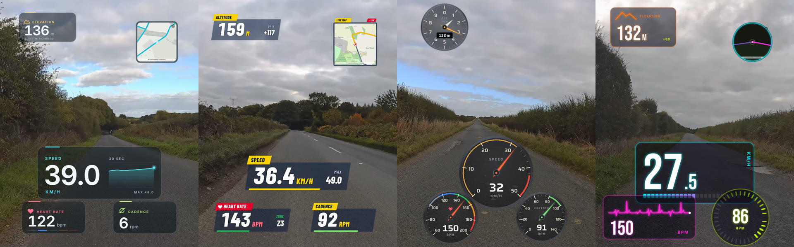

# Ride Studio — developer alpha

Create cycling, running and hiking videos from local camera footage and FIT/GPX activities. The studio includes a telemetry widget gallery, timeline editing, photos, manual map synchronization and MP4 export. All activity and media processing stays on your computer; street maps request tiles through a local cache.

This is an early developer alpha for macOS (Apple silicon) and Linux (x64, tested on Ubuntu 24.04 and 26.04). Windows (x64) support is experimental: partial Windows 11 synthetic testing passed, with clean-machine setup and real-media acceptance still pending. The Electron application is runnable and can be packaged locally, but still requires the documented external FFmpeg and metadata tools. Installers are not signed/notarized. This branch is a curated source snapshot with no earlier Git history.



*A real ride by Eccup Reservoir and Golden Acre Park, Leeds: Garmin Edge FIT telemetry over Varia Vue footage in the four HUD design families. See the [real ride example](docs/real-ride-example.md) for the telemetry, sync check and export results.*

## Start on macOS

Install Homebrew first, then:

```sh
scripts/setup-macos.sh
export PATH="$(brew --prefix node@24)/bin:$PATH"
cd studio
npm run desktop
```

## Start on Linux

On Debian or Ubuntu, with Node.js 22.12 or later installed (for example from nodejs.org or nvm):

```sh
scripts/setup-linux.sh
cd studio
npm run desktop
```

`npm run desktop:package` builds an installable `.deb` and a `.tar.gz` under `studio/release/`. Exports use NVIDIA NVENC when available and libx264 otherwise.

## Start on Windows (experimental)

On Windows 10 or 11 with winget (App Installer), from PowerShell:

```powershell
powershell -ExecutionPolicy Bypass -File scripts\setup-windows.ps1
cd studio
npm run desktop
```

The script installs Node.js, Python, FFmpeg and ExifTool with winget. `npm run desktop:package` builds a portable `.zip` under `studio\release\`; CI also attaches one to every run. Exports try NVIDIA NVENC, Intel Quick Sync and AMD AMF before falling back to libx264. The build is unsigned, so SmartScreen warns on first launch.

## Try it

Use **File → Load synthetic demo** to try the editor without supplying any private files. The demo generates its own telemetry and test-pattern video. Import saved FIT/GPX activities from the Activities page and add videos/photos in the editor. The original files and previous exports are preserved.

Read [desktop setup, workflow and limits](docs/desktop-alpha.md) and the [support matrix](docs/support-matrix.md). Native camera GPS support varies by camera and recording schema. Synchronization is approximate; raw 360, HDR/log, changed playback speed and automatic FIT/camera sensor merging are not supported claims for this alpha. Route privacy hides the start/finish and hides the whole map when no public section can be established. Check the actual exported video before sharing it.

## Develop and verify

Node 24 is recommended; minimum Node 22.12. From `studio/`:

```sh
npm ci
npm run typecheck
npm run desktop:build
node scripts/test_desktop_server.mjs
npm run desktop:smoke
npm run desktop:package
```

For the browser development UI, run `npm run demo` and `npm run dev`. The backend is for local use, not public hosting. Desktop data lives in the application's user-data library; generated media and dependency/build directories are excluded from source control and application builds.

The Python implementations remain developer reference/test tools. Running their unit and parity tests requires the separate exact versions in `requirements.txt`; the application uses the TypeScript FIT/GPX importers and does not ship Garmin's proprietary SDK. The same verification runs in GitHub Actions (`.github/workflows/verify.yml`) and Gitea (`.gitea/workflows/verify.yml`): builds, importer parity, backend/export regressions, the Electron smoke under Xvfb and the Linux packages.

## Distribution status

The application currently uses installed FFmpeg/FFprobe and external Python/Pillow/ExifTool helpers for camera/photo/Apple Health metadata. Fully bundled dependencies, signed/notarized installers, older macOS/Intel acceptance, VAAPI/Quick Sync encoding on Linux, Linux arm64 and other distributions, Windows acceptance on real hardware and automatic updates remain release work. See [FFmpeg build notes](packaging/ffmpeg/README.md).

Project code is [MIT licensed](LICENSE). See [third-party notices](THIRD_PARTY_NOTICES.md). Existing fonts are retained in this alpha; their own license files apply. No private recordings, GPS traces, Garmin SDK binaries or third-party test corpus are included.
