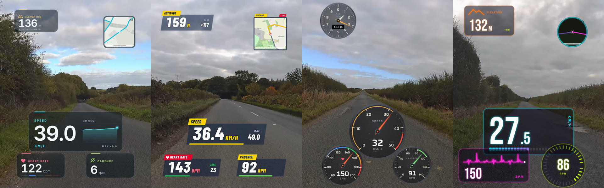
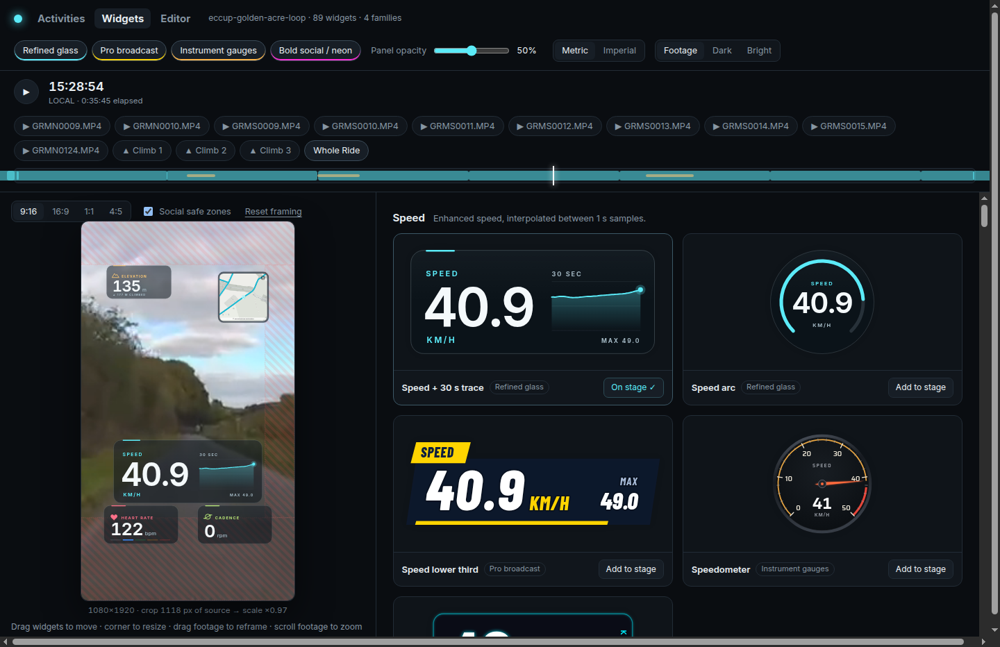
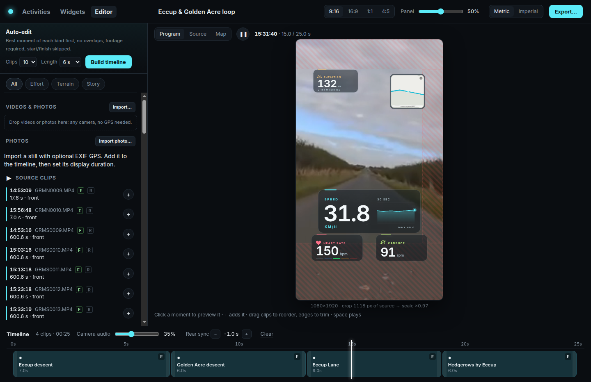
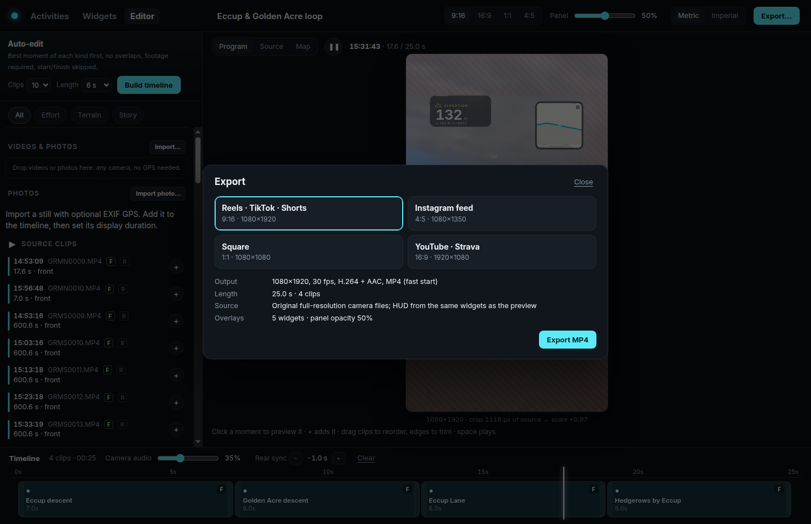

# Real ride example: Eccup Reservoir and Golden Acre Park, Leeds

A worked example with real inputs: a 25 km road ride recorded on a Garmin Edge with a Varia Vue front camera and an RCT715 rear camera, edited and exported with the Linux desktop alpha on 30 October 2026. Every number below was measured from these files; nothing is synthetic. Passages shown publicly were chosen well away from the start and finish, the street map hides the route near both ends, and no people or number plates are in shot.

*Glass, Broadcast, Gauge and Neon families on the same ride (4:5 exports). Values are the recorded FIT samples at those frames; low cadence on the first frame is real coasting on a descent.*

## Activity telemetry (FIT)

Imported through the bundled TypeScript FIT importer (no Python, no Garmin SDK): 3,827 records at 1 s, 25.02 km in 1:03:46, sport cycling, sub-sport road.

| Channel | FIT source field | Samples present | Range in this ride | Widget examples |
| --- | --- | --- | --- | --- |
| Speed | `enhanced_speed` (fallback `speed`) | 3,827 / 3,827 | 0 to 49.0 km/h | speed trace, speedometer, lower third |
| Heart rate | `heart_rate` | 3,827 / 3,827 | 94 to 167 bpm (average 146) | HR with zones, ECG trace, dial |
| Cadence | `cadence` | 3,819 / 3,827, of which 723 genuine zeros | 0 to 117 rpm (FIT summary average 75) | cadence card, dial |
| Altitude | `enhanced_altitude` (fallback `altitude`) | 3,826 / 3,827 | 114 to 166 m, 272 m total ascent | elevation, profile, gradient |
| Distance | `distance` | 3,827 / 3,827 | 0 to 25.02 km | distance, splits |
| Position | `position_lat` / `position_long` | 3,827 / 3,827 | | street map, route map, heading |
| Temperature | `temperature` | 3,827 / 3,827 | 13 to 21 °C (device reading) | temperature |
| Respiration | `enhanced_respiration_rate` | 3,785 / 3,827 | 20.5 to 38.2 breaths/min (Garmin estimate) | respiration |

Speed and altitude are interpolated between samples; heart rate and cadence use the preceding recorded sample. Zero cadence while coasting is kept as zero, and the 42 missing respiration samples stay missing rather than being filled.

## Camera footage

| Camera | Original | Preview file | Notes |
| --- | --- | --- | --- |
| Varia Vue (front) | 2688 × 2160 HEVC, 29.97 fps, about 32 Mbit/s, AAC; continuous 10-minute `GRMS` segments | `GLV`, 640 × 360 HEVC | Burned-in strip with clock, position and speed, cropped out by the default framing |
| Varia RCT715 (rear) | 1920 × 1080 H.264, 29.97 fps, 16-bit PCM; 30-second `GRMN` clips | `GLV`, 640 × 368 H.264 | Rear clips on this ride end before the activity starts, so no rear inset is used |

Chromium plays HEVC only through platform decoders, so on Linux the studio makes a cached H.264 proxy of each Vue preview (about 10 s per 10-minute GLV with NVENC). Exports always read the full-resolution originals through FFmpeg.

## Synchronization check

Clips are placed from the container creation time (UTC). Checked against the camera's burned-in clock and the FIT speed at two points 42 minutes apart, in different files:

| Check | Burned-in clock gives ride time | Container time gives ride time | FIT speed at that second |
| --- | --- | --- | --- |
| Early in the ride | 381 s | 382 s | 29.5 mph (camera shows 29 mph) |
| 42 minutes later | 2891 s | 2892 s | 13.6 mph |

Agreement is within one second with no drift, so no per-clip correction was needed. One-second agreement does not establish sub-second sensor latency.

## Export results on Linux

Ubuntu 24.04 x64, 16 threads, NVIDIA RTX 3090, distribution FFmpeg 6.1.1, installed `.deb`:

| Export | Result | Time |
| --- | --- | --- |
| 9:16, three 10-second front passages, speed/HR/cadence/elevation | 900 frames, 30.0 s, 1080 × 1920 H.264 (NVENC) + AAC, full decode clean, HUD values equal to the FIT at the checked frames | 71 s |
| 4:5, one 7-second passage, five widgets including street map | 210 frames, 1080 × 1350 | 17 s |

Source decoding of the Vue's 2.7K HEVC runs in software on Linux (20 s of footage decoded in 10.9 s; NVDEC would take 2.2 s), so HUD capture and compositing, not decoding, set the export time.

## Screens

*Widget gallery at a 41 km/h descent near Eccup Reservoir: the stage (left) previews the chosen layout over the footage; cards (right) show every widget with live values.*

*Timeline editor with four passages near Eccup Reservoir and Golden Acre Park, source clips listed by recording time, and the program preview.*

*Export dialog with social format presets.*
